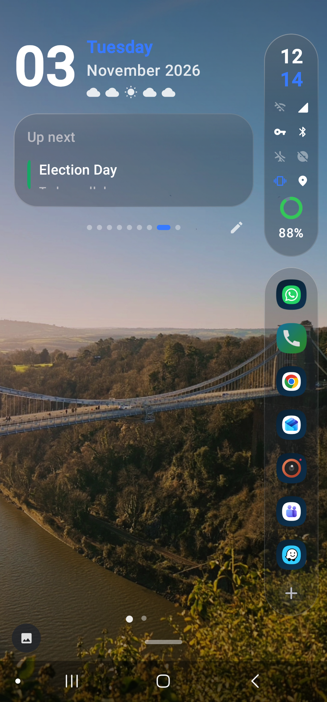
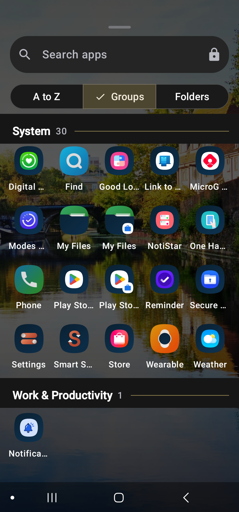
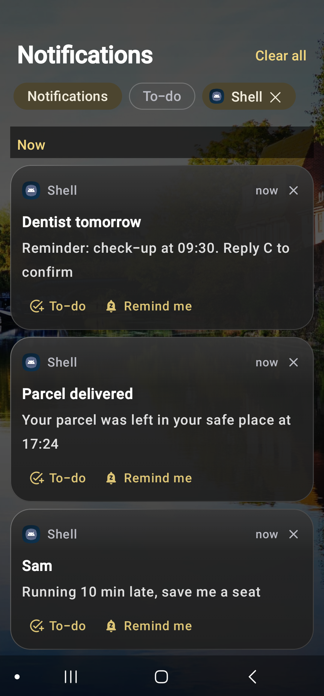
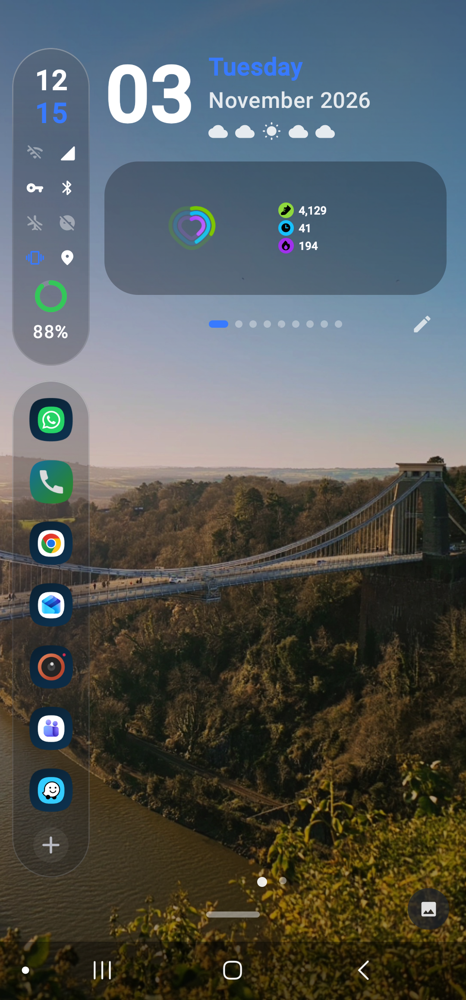

# Ember

**A one-handed Android launcher that brings your forgotten photos back, sorts your apps for you, and never lets a
notification slip away.**

<p align="center">
  
  
  
  
</p>

I built Ember for myself, and these four problems are why.

## 1. Your photos, remembered

Most of the photos we take are never opened again. They sit in the gallery for years, thousands of them, and the good
ones get buried under the blurry ones.

Ember puts them back in front of you. Every 30 minutes (or three times a day) it sets one of your own photos as the
wallpaper, choosing sharp ones and portrait shots with a soft background, cropped around the subject. On the right day
it picks **"3 years ago today"**. A tiny button in the corner tells you where and when it was taken.

And it turns that into a gentle clean-up of your gallery:

- **♥ keeps it.** The photo is copied to `Pictures/Ember Memories`, a folder of the moments you actually love (the
  original stays where it was). Back it up, share it, print it.
- **👎 sets it aside.** It never comes back as a wallpaper, and it waits in **Review & clean**, where all your 👎 photos
  go to Android's trash in one tap (restorable for 30 days). Nothing is ever deleted without you seeing it first.
- **Choose where photos come from:** all camera photos, only the albums you pick, or only your favourites.

For bigger clean-ups (bursts, near-duplicates, the same shot eight times), Ember opens its sibling app
[Photo Selector](https://github.com/harsharede/photo_selector) when it's installed.

## 2. Made for one small hand

I have small hands, and big phones are built for two. In Ember everything you touch is on one edge, under your thumb:

- **The rail**: the time, Wi-Fi, Bluetooth, battery and the rest, with your favourite apps below. As many apps as you
  like; it scrolls when the status grows.
- **Left-handed or right-handed in one gesture.** Double-tap the time, or drag the rail across the screen, and
  everything moves to the other side: the rail, the app drawer's A to Z letters, the wallpaper button.
- **Swipe up anywhere** for apps, **swipe down anywhere** for notifications. No reaching for the top of the screen.
- The A to Z strip swells like a wave under your thumb, with a tick on every letter.
- Rail width, dock height, shape (round or rounded rectangle) and transparency are all adjustable.

## 3. App grouping, done by AI

I'm terrible at organising apps. Ember groups them for you (Social, Messaging, Work, Money, Travel…) and if it gets
some wrong, **Sort with AI** sends your app list (names only) to Claude, ChatGPT or Gemini through the share sheet.
Share the answer back and Ember shows the new groups before applying them. No API keys, and Ember itself sends nothing:
you choose what to share. You can still move any app by hand.

## 4. Notifications you can't lose

A notification arrives, you swipe it away "for later", and it's gone forever. Ember fixes that:

- **To-do**: on any notification, tap **To-do** and it stays in your to-do list after the notification is gone, with
  a tap to open it again. Tick it off when it's done. It's on the notification page and can be a Smart Stack card.
- **Remind me** in 3, 5, 15 or 30 minutes or an hour, and it comes back.
- **Reply** right from the list, without opening the app.
- **No banners over what you're doing**: a small light glows in the corner instead, like old phones had. With the screen
  off, the screen wakes black and only that light blinks: an LED for phones that don't have one.

## And also

- **Smart Stack**: one card that flips every few seconds between weather, what's playing, your next event, screen
  time, your to-do list, people you chat with, YouTube or Reddit posts, and any widget.
- **Weather** beside the date for the next five hours, and rain, snow, clouds or stars drawn over the wallpaper.
- **Status icons that do something**: tap Wi-Fi for the internet panel, Do Not Disturb to turn it off, the ringer to
  switch ring, vibrate and silent.
- **Focus mode**, **hidden apps** behind your fingerprint, **icon packs**, **Material You** colours from the wallpaper,
  **smart search** (sums, unit conversions, contacts), extra **pages** for widgets and a page with nothing but the
  wallpaper.

Made on a Galaxy S23 Ultra; works on any phone with Android 12 or later.

## Install

- **GitHub Releases**: download the latest `ember-vX.Y.Z.apk` from
  [Releases](https://github.com/harsharede/Ember/releases).
- **Obtainium**: add `https://github.com/harsharede/Ember` to get updates automatically.
- **F-Droid**: coming soon.

Then open **Ember settings** and switch on, in order: Use Ember as your Home app, Notification access, Display over
other apps. If Notification access is greyed out (Android 13+ does this for apps installed from a file): App info › ⋮ ›
Allow restricted settings, then try again.

## Privacy

Ember has no ads, no analytics, no accounts and no tracking. Your photos, notifications, contacts and app usage are read
on the phone and never leave it. The **only** network request is the weather forecast (Open-Meteo, free and keyless),
sent with a location rounded to about a kilometre, or the city you chose, and only if you use the weather.

Every permission is optional except notification access (the core of Ember) and is asked for only when you switch on
the feature that needs it:

| Permission | Why |
|---|---|
| Notification access | The notification page, to-do, reply, reminders, the light and the count on the rail |
| Display over other apps | The light in the corner while another app is open, and waking the screen for the lock-screen light |
| Query all packages | Listing your apps (every launcher needs this) |
| Photos, photo locations | Wallpapers from your photos, Ember Memories, Review & clean, and naming where a photo was taken |
| Internet, approximate location | The weather forecast only (or choose a city and skip location) |
| Contacts, calendar | The People and Up next cards, and contacts in search |
| Usage access, notifications | The Screen time card and its gentle limit reminders |
| Do Not Disturb access | Turning Do Not Disturb off from its icon |
| Biometric | Unlocking hidden apps |
| Set wallpaper, wake lock, turn screen on | Changing the wallpaper and the lock-screen light |

## Building

```
git clone https://github.com/harsharede/Ember
cd Ember
./gradlew :app:assembleDebug
```

Needs JDK 17 and the Android SDK (Android Studio has both). Every push is built and tested by GitHub Actions; tagged
versions are signed and published by the Release workflow (see [RELEASING.md](RELEASING.md)).

Contributions are welcome: issues, ideas and pull requests. Ember is written in Kotlin with Jetpack Compose, one
feature per file in `app/src/main/java/com/harsharede/ember/`.

## License

MIT, see [LICENSE](LICENSE).
